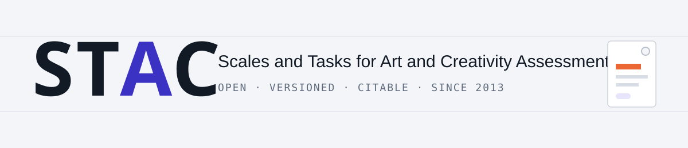
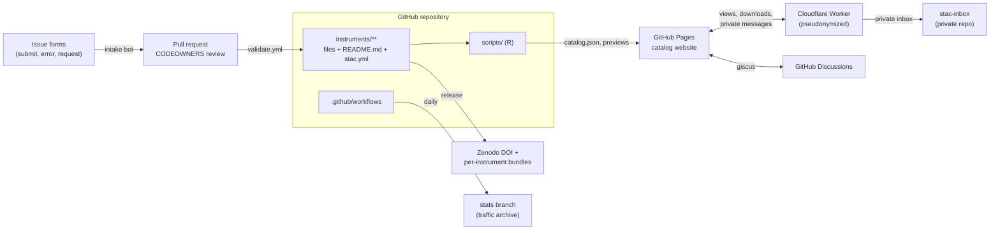

<picture>
  <source media="(prefers-color-scheme: dark)" srcset="docs/assets/banner-dark.svg">
  
</picture>

<p align="center">
  <a href="https://stac-archive.github.io/stac/"><b>Browse the catalog</b></a> ·
  <a href="https://github.com/stac-archive/stac/issues/new?template=01-new-instrument.yml">Submit a measure</a> ·
  <a href="https://github.com/stac-archive/stac/discussions">Discussions</a> ·
  <a href="#how-to-cite">How to cite</a> ·
  <a href="https://stac-archive.github.io/stac/#/dashboard">Dashboard</a>
</p>

<p align="center">
<!-- STAC:BADGES:START -->
   
<!-- STAC:BADGES:END -->
<a href="https://doi.org/10.1027/2698-1866/a000140"></a>
<a href="https://doi.org/10.17605/OSF.IO/4S9P6"></a>
<a href="https://github.com/stac-archive/stac/actions/workflows/validate.yml"></a>
<a href="https://github.com/stac-archive/stac/actions/workflows/build-deploy.yml"></a>
</p>

**STAC** is a curated, open archive of scales and tasks for research on creativity, aesthetics and the arts, plus individual-differences measures often used alongside them. It was created in 2013 by Paul Silvia on the Open Science Framework and is moderated by Mathias Benedek, Yoed N. Kenett and Paul J. Silvia, with support from APA Division 10 and the Society for the Neuroscience of Creativity ([Kenett, Silvia & Benedek, 2026](https://doi.org/10.1027/2698-1866/a000140)).

This repository is the archive's GitHub home: every file is versioned, every change is reviewed, every release gets a DOI, and the [catalog website](https://stac-archive.github.io/stac/) previews all files in the browser, including Qualtrics and MediaLab survey files.

> [!IMPORTANT]
> **Use the original references.** Each instrument folder lists the source for every language version. Cite those, and cite STAC as the access point when helpful. Materials are free for academic and non-commercial use unless the folder states otherwise; see [Licensing](#licensing).

> [!NOTE]
> **Migrated 1:1 from OSF.** All files were copied byte-identically from [osf.io/4s9p6](https://osf.io/4s9p6) (SHA-256 checked, map in [`migration/osf_path_map.csv`](migration/osf_path_map.csv)). Issues found in the legacy files are listed in the [migration audit](docs/audit-report.md) and shown on each instrument page; they are fixed through reviewed pull requests, never silently.

## Find a measure

The fastest way is the [catalog](https://stac-archive.github.io/stac/): full-text search with typo tolerance, filters for section, language, survey platform, file type and access tier, previews of PDF, Word, Excel, Qualtrics (`.qsf`), MediaLab (`.que`) and task archives, and copy-ready citations per file. The tables below are regenerated on every change.

<!-- STAC:TABLES:START -->
<details><summary><b>Art and Aesthetics</b> (15)</summary>

| Instrument | Languages | Formats | Access | |
|---|---|---|---|---|
| [**AEQ** Art Experience Questionnaire](instruments/art-and-aesthetics/aeq-art-experience-questionnaire) | English | `que` | Academic / non-commercial | [view](https://stac-archive.github.io/stac/#/instrument/aeq-art-experience-questionnaire) |
| [**AERS** Art Engagement Reflection Scale](instruments/art-and-aesthetics/aers-art-engagement-reflection-scale) | English | `docx` `pdf` | Academic / non-commercial | [view](https://stac-archive.github.io/stac/#/instrument/aers-art-engagement-reflection-scale) |
| [**Aesthemos** Aesthetic Emotions Scale](instruments/art-and-aesthetics/aesthemos-aesthetic-emotions-scale) | English | `docx` `pdf` | Academic / non-commercial | [view](https://stac-archive.github.io/stac/#/instrument/aesthemos-aesthetic-emotions-scale) |
| [**AFS** Aesthetic Fluency Scale](instruments/art-and-aesthetics/afs-aesthetic-fluency-scale) | English | `docx` `pdf` `qsf` `que` | Academic / non-commercial | [view](https://stac-archive.github.io/stac/#/instrument/afs-aesthetic-fluency-scale) |
| [**AGH** Actividad Gráfica como Herramienta](instruments/art-and-aesthetics/agh-actividad-grafica-como-herramienta) | Spanish | `pdf` | Academic / non-commercial | [view](https://stac-archive.github.io/stac/#/instrument/agh-actividad-grafica-como-herramienta) |
| [**APPS** Aesthetic Processing Preference Scale](instruments/art-and-aesthetics/apps-aesthetic-processing-preference-scale) | English | `docx` `pdf` `qsf` | Academic / non-commercial | [view](https://stac-archive.github.io/stac/#/instrument/apps-aesthetic-processing-preference-scale) |
| [**AReA** Aesthetic Responsiveness Assessment](instruments/art-and-aesthetics/area-aesthetic-responsiveness-assessment) | German, English, Farsi | `docx` `pdf` `qsf` | Academic / non-commercial | [view](https://stac-archive.github.io/stac/#/instrument/area-aesthetic-responsiveness-assessment) |
| [**BAIS** Bucknell Auditory Imagery Scale](instruments/art-and-aesthetics/bais-bucknell-auditory-imagery-scale) | English | `que` | Academic / non-commercial | [view](https://stac-archive.github.io/stac/#/instrument/bais-bucknell-auditory-imagery-scale) |
| [**GMSI** Goldsmith Musical Sophistication Index](instruments/art-and-aesthetics/gmsi-goldsmith-musical-sophistication-index) | English | `pdf` `que` | Academic / non-commercial | [view](https://stac-archive.github.io/stac/#/instrument/gmsi-goldsmith-musical-sophistication-index) |
| [**IMIS** Involuntary Musical Imagery Scale](instruments/art-and-aesthetics/imis-involuntary-musical-imagery-scale) | English | `pdf` `que` | Academic / non-commercial | [view](https://stac-archive.github.io/stac/#/instrument/imis-involuntary-musical-imagery-scale) |
| [**LOL** Loathing of Legerdemain Magic Attitudes Scale](instruments/art-and-aesthetics/lol-loathing-of-legerdemain-magic-attitudes-scale) | English, Polish | `docx` `pdf` `qsf` | Academic / non-commercial | [view](https://stac-archive.github.io/stac/#/instrument/lol-loathing-of-legerdemain-magic-attitudes-scale) |
| [**PAI** Product Aesthetics Inventory](instruments/art-and-aesthetics/pai-product-aesthetics-inventory) | German, English | `docx` | Academic / non-commercial | [view](https://stac-archive.github.io/stac/#/instrument/pai-product-aesthetics-inventory) |
| [**STOMP** Short Test of Musical Preferences](instruments/art-and-aesthetics/stomp-short-test-of-musical-preferences) | English | `pdf` | Academic / non-commercial | [view](https://stac-archive.github.io/stac/#/instrument/stomp-short-test-of-musical-preferences) |
| [**UAES** Unusual Aesthetic Experiences Scale](instruments/art-and-aesthetics/uaes-unusual-aesthetic-experiences-scale) | English | `docx` `pdf` `qsf` `que` | Academic / non-commercial | [view](https://stac-archive.github.io/stac/#/instrument/uaes-unusual-aesthetic-experiences-scale) |
| [**VAIAK** Vienna Art Interest and Art Knowledge Questionnaire](instruments/art-and-aesthetics/vaiak-vienna-art-interest-and-art-knowledge-questionnaire) | German, English, Dutch | `docx` `pdf` | Academic / non-commercial | [view](https://stac-archive.github.io/stac/#/instrument/vaiak-vienna-art-interest-and-art-knowledge-questionnaire) |

</details>
<details><summary><b>Creativity: Methods and Scoring</b> (3)</summary>

| Instrument | Languages | Formats | Access | |
|---|---|---|---|---|
| [Be creative Instructions](instruments/creativity/tasks/methods-and-scoring/be-creative-instructions) | English | `pdf` | Academic / non-commercial | [view](https://stac-archive.github.io/stac/#/instrument/be-creative-instructions) |
| [SemDis](instruments/creativity/tasks/methods-and-scoring/semdis) | English | `docx` `pdf` | Academic / non-commercial | [view](https://stac-archive.github.io/stac/#/instrument/semdis) |
| [Subjective Scoring Guidelines](instruments/creativity/tasks/methods-and-scoring/subjective-scoring-guidelines) | English | `pdf` | Academic / non-commercial | [view](https://stac-archive.github.io/stac/#/instrument/subjective-scoring-guidelines) |

</details>
<details><summary><b>Creativity: Self-Report Scales</b> (29)</summary>

| Instrument | Languages | Formats | Access | |
|---|---|---|---|---|
| [**BICB** Biographical Inventory of Creative Behaviors](instruments/creativity/self-report-scales/bicb-biographical-inventory-of-creative-behaviors) | English, French | `doc` `docx` `pdf` `que` | Academic / non-commercial | [view](https://stac-archive.github.io/stac/#/instrument/bicb-biographical-inventory-of-creative-behaviors) |
| [**CA** Creative Adaptability](instruments/creativity/self-report-scales/ca-creative-adaptability) | English | `docx` | Academic / non-commercial | [view](https://stac-archive.github.io/stac/#/instrument/ca-creative-adaptability) |
| [**CActD** Creative Activities across Domains](instruments/creativity/self-report-scales/cactd-creative-activities-across-domains) | German, English | `docx` | Academic / non-commercial | [view](https://stac-archive.github.io/stac/#/instrument/cactd-creative-activities-across-domains) |
| [**CAQ** Creative Achievement Questionnaire](instruments/creativity/self-report-scales/caq-creative-achievement-questionnaire) | German, English, French | `docx` `pdf` `que` | Academic / non-commercial | [view](https://stac-archive.github.io/stac/#/instrument/caq-creative-achievement-questionnaire) |
| [**CAS** Creative Actions Scale](instruments/creativity/self-report-scales/cas-creative-actions-scale) | Spanish | `docx` `pdf` | Academic / non-commercial | [view](https://stac-archive.github.io/stac/#/instrument/cas-creative-actions-scale) |
| [**CBI** Creative Behavior Inventory](instruments/creativity/self-report-scales/cbi-creative-behavior-inventory) | German, English | `pdf` `que` | Academic / non-commercial | [view](https://stac-archive.github.io/stac/#/instrument/cbi-creative-behavior-inventory) |
| [**CMF** Creativity Myths-Facts](instruments/creativity/self-report-scales/cmf-creativity-myths-facts) | German, English, Japanese | `docx` `pdf` | Academic / non-commercial | [view](https://stac-archive.github.io/stac/#/instrument/cmf-creativity-myths-facts) |
| [**CPAC** Cognitive Processes Associated with Creativity](instruments/creativity/self-report-scales/cpac-cognitive-processes-associated-with-creativity) | English | `docx` `pdf` | Academic / non-commercial | [view](https://stac-archive.github.io/stac/#/instrument/cpac-cognitive-processes-associated-with-creativity) |
| [**CPS** Creative Personality Scale](instruments/creativity/self-report-scales/cps-creative-personality-scale) | English | `docx` `pdf` | Academic / non-commercial | [view](https://stac-archive.github.io/stac/#/instrument/cps-creative-personality-scale) |
| [**CSES** Creative Self-Efficacy Scale](instruments/creativity/self-report-scales/cses-creative-self-efficacy-scale) | English | `pdf` | Academic / non-commercial | [view](https://stac-archive.github.io/stac/#/instrument/cses-creative-self-efficacy-scale) |
| [**CTM** Creative Trait Motivation Scale](instruments/creativity/self-report-scales/ctm-creative-trait-motivation-scale) | English | `pdf` | Academic / non-commercial | [view](https://stac-archive.github.io/stac/#/instrument/ctm-creative-trait-motivation-scale) |
| [**CTP** Creative Thinking Profile](instruments/creativity/self-report-scales/ctp-creative-thinking-profile) | English | `pdf` | Academic / non-commercial | [view](https://stac-archive.github.io/stac/#/instrument/ctp-creative-thinking-profile) |
| [**DFIS** Dual Facet Imagination Scale](instruments/creativity/self-report-scales/dfis-dual-facet-imagination-scale) | German, English, Turkish | `docx` `qsf` | Academic / non-commercial | [view](https://stac-archive.github.io/stac/#/instrument/dfis-dual-facet-imagination-scale) |
| [**ECI** Emotional Creativity Inventory](instruments/creativity/self-report-scales/eci-emotional-creativity-inventory) | German, English | `docx` `pdf` | Academic / non-commercial | [view](https://stac-archive.github.io/stac/#/instrument/eci-emotional-creativity-inventory) |
| [**FFIS** Four-Factor Imagination Scale](instruments/creativity/self-report-scales/ffis-four-factor-imagination-scale) | English | `docx` `pdf` | Academic / non-commercial | [view](https://stac-archive.github.io/stac/#/instrument/ffis-four-factor-imagination-scale) |
| [**HEISS** Humor Efficacy and Identity Short Scales](instruments/creativity/self-report-scales/heiss-humor-efficacy-and-identity-short-scales) | German, English, Polish | `docx` `pdf` `qsf` | Academic / non-commercial | [view](https://stac-archive.github.io/stac/#/instrument/heiss-humor-efficacy-and-identity-short-scales) |
| [**HSQ** Humor Styles Questionnaire](instruments/creativity/self-report-scales/hsq-humor-styles-questionnaire) | English | `doc` `pdf` `qsf` `que` | Academic / non-commercial | [view](https://stac-archive.github.io/stac/#/instrument/hsq-humor-styles-questionnaire) |
| [**ICAA** Inventory of Creative Activities and Achievements](instruments/creativity/self-report-scales/icaa-inventory-of-creative-activities-and-achievements) | German, English, French, Japanese | `docx` `pdf` | Academic / non-commercial | [view](https://stac-archive.github.io/stac/#/instrument/icaa-inventory-of-creative-activities-and-achievements) |
| [**ICAYA** Inventory of Creative Activities for Young Adolescents](instruments/creativity/self-report-scales/icaya-inventory-of-creative-activities-for-young-adolescents) | German | `pdf` `xlsx` | Academic / non-commercial | [view](https://stac-archive.github.io/stac/#/instrument/icaya-inventory-of-creative-activities-for-young-adolescents) |
| [**K-DOCS** Kaufman Domains of Creativity Scale](instruments/creativity/self-report-scales/k-docs-kaufman-domains-of-creativity-scale) | Arabic, English, French, Korean, Russian, Turkish | `docx` `pdf` `xlsx` | Academic / non-commercial | [view](https://stac-archive.github.io/stac/#/instrument/k-docs-kaufman-domains-of-creativity-scale) |
| [**MoCS** Motives for Creativity Scale](instruments/creativity/self-report-scales/mocs-motives-for-creativity-scale) | German, English | `docx` | Academic / non-commercial | [view](https://stac-archive.github.io/stac/#/instrument/mocs-motives-for-creativity-scale) |
| [**MSI** Mode Shifting Index](instruments/creativity/self-report-scales/msi-mode-shifting-index) | English | `docx` `pdf` | Academic / non-commercial | [view](https://stac-archive.github.io/stac/#/instrument/msi-mode-shifting-index) |
| [**NCM** Negative Creativity Measure](instruments/creativity/self-report-scales/ncm-negative-creativity-measure) | English | `pdf` | Academic / non-commercial | [view](https://stac-archive.github.io/stac/#/instrument/ncm-negative-creativity-measure) |
| [**RIBS** Runco Ideational Behavior Scale](instruments/creativity/self-report-scales/ribs-runco-ideational-behavior-scale) | German, English, French | `docx` `pdf` | Academic / non-commercial | [view](https://stac-archive.github.io/stac/#/instrument/ribs-runco-ideational-behavior-scale) |
| [**SoCSC** Sources of Creative Self-concept](instruments/creativity/self-report-scales/socsc-sources-of-creative-self-concept) | German, English | `docx` | Academic / non-commercial | [view](https://stac-archive.github.io/stac/#/instrument/socsc-sources-of-creative-self-concept) |
| [**SPC** Self Perceptions of Creativity](instruments/creativity/self-report-scales/spc-self-perceptions-of-creativity) | English | `docx` `pdf` | Academic / non-commercial | [view](https://stac-archive.github.io/stac/#/instrument/spc-self-perceptions-of-creativity) |
| [**SSCS** Short Scale of Creative Self](instruments/creativity/self-report-scales/sscs-short-scale-of-creative-self) | English | `doc` `pdf` `qsf` | Academic / non-commercial | [view](https://stac-archive.github.io/stac/#/instrument/sscs-short-scale-of-creative-self) |
| [**TIntS** Types of Intuition Scale](instruments/creativity/self-report-scales/tints-types-of-intuition-scale) | English | `pdf` `que` | Academic / non-commercial | [view](https://stac-archive.github.io/stac/#/instrument/tints-types-of-intuition-scale) |
| [**TopCA** Top Creative Achievements](instruments/creativity/self-report-scales/topca-top-creative-achievements) | German, English | `docx` | Academic / non-commercial | [view](https://stac-archive.github.io/stac/#/instrument/topca-top-creative-achievements) |

</details>
<details><summary><b>Creativity: Tasks</b> (17)</summary>

| Instrument | Languages | Formats | Access | |
|---|---|---|---|---|
| [Analogy Finding Task](instruments/creativity/tasks/analogy-finding-task) | English | `docx` `pdf` | Academic / non-commercial | [view](https://stac-archive.github.io/stac/#/instrument/analogy-finding-task) |
| [**AQT** Alternative Questions Task](instruments/creativity/tasks/aqt-alternative-questions-task) |  | `qsf` | Academic / non-commercial | [view](https://stac-archive.github.io/stac/#/instrument/aqt-alternative-questions-task) |
| [**AUT** Alternate Uses Task](instruments/creativity/tasks/aut-alternate-uses-task) |  | `docx` `pdf` `que` `zip` | Academic / non-commercial | [view](https://stac-archive.github.io/stac/#/instrument/aut-alternate-uses-task) |
| [Cartoon Captions](instruments/creativity/tasks/cartoon-captions) | English | `jpg` `que` | Academic / non-commercial | [view](https://stac-archive.github.io/stac/#/instrument/cartoon-captions) |
| [**CPS** Creative Problem Solving](instruments/creativity/tasks/cps-creative-problem-solving) |  | `pdf` `qsf` | Academic / non-commercial | [view](https://stac-archive.github.io/stac/#/instrument/cps-creative-problem-solving) |
| [Creative Metaphor Task](instruments/creativity/tasks/creative-metaphor-task) | English | `docx` `pdf` `que` | Academic / non-commercial | [view](https://stac-archive.github.io/stac/#/instrument/creative-metaphor-task) |
| [**DAT** Divergent Association Task](instruments/creativity/tasks/dat-divergent-association-task) |  | `pdf` `qsf` | Academic / non-commercial | [view](https://stac-archive.github.io/stac/#/instrument/dat-divergent-association-task) |
| [**FGAT** Free Generation of Associations Task](instruments/creativity/tasks/fgat-free-generation-of-associations-task) |  | `zip` | Academic / non-commercial | [view](https://stac-archive.github.io/stac/#/instrument/fgat-free-generation-of-associations-task) |
| [Forward Flow](instruments/creativity/tasks/forward-flow) |  | `pdf` `qsf` | Academic / non-commercial | [view](https://stac-archive.github.io/stac/#/instrument/forward-flow) |
| [Funny Definitions Task](instruments/creativity/tasks/funny-definitions-task) | English | `docx` `pdf` `que` | Academic / non-commercial | [view](https://stac-archive.github.io/stac/#/instrument/funny-definitions-task) |
| [Joke Stems Task](instruments/creativity/tasks/joke-stems-task) | English | `docx` `pdf` `qsf` `que` | Academic / non-commercial | [view](https://stac-archive.github.io/stac/#/instrument/joke-stems-task) |
| [**PolyFT** Polysemous Associative Fluency Task](instruments/creativity/tasks/polyft-polysemous-associative-fluency-task) |  | `zip` | Academic / non-commercial | [view](https://stac-archive.github.io/stac/#/instrument/polyft-polysemous-associative-fluency-task) |
| [Quirky Questions Task](instruments/creativity/tasks/quirky-questions-task) | English | `docx` `pdf` `qsf` | Academic / non-commercial | [view](https://stac-archive.github.io/stac/#/instrument/quirky-questions-task) |
| [**RAT** Remote Associates Task](instruments/creativity/tasks/rat-remote-associates-task) | English, French | `zip` | Academic / non-commercial | [view](https://stac-archive.github.io/stac/#/instrument/rat-remote-associates-task) |
| [**RAUT** Reversed Alternate Uses Task](instruments/creativity/tasks/raut-reversed-alternate-uses-task) | English, Korean | `docx` `pdf` | Academic / non-commercial | [view](https://stac-archive.github.io/stac/#/instrument/raut-reversed-alternate-uses-task) |
| [**SCTT** Scientific creative thinking test](instruments/creativity/tasks/sctt-scientific-creative-thinking-test) |  | `docx` `pdf` `qsf` | Academic / non-commercial | [view](https://stac-archive.github.io/stac/#/instrument/sctt-scientific-creative-thinking-test) |
| [**SGT** Story Generation Task](instruments/creativity/tasks/sgt-story-generation-task) |  | `pdf` `qsf` | Academic / non-commercial | [view](https://stac-archive.github.io/stac/#/instrument/sgt-story-generation-task) |

</details>
<details><summary><b>Personality and Individual Differences</b> (26)</summary>

| Instrument | Languages | Formats | Access | |
|---|---|---|---|---|
| [**5DCS** Five Dimensions Curiosity Scale](instruments/personality-and-individual-differences/5dcs-five-dimensions-curiosity-scale) |  | `pdf` `qsf` | Academic / non-commercial | [view](https://stac-archive.github.io/stac/#/instrument/5dcs-five-dimensions-curiosity-scale) |
| [**ACIPS** Anticipatory and Consummatory Interpersonal Pleasure Scale](instruments/personality-and-individual-differences/acips-anticipatory-and-consummatory-interpersonal-pleasure-scale) | English | `que` | Academic / non-commercial | [view](https://stac-archive.github.io/stac/#/instrument/acips-anticipatory-and-consummatory-interpersonal-pleasure-scale) |
| [**AHS** Adult Hope Scale](instruments/personality-and-individual-differences/ahs-adult-hope-scale) | English | `que` | Academic / non-commercial | [view](https://stac-archive.github.io/stac/#/instrument/ahs-adult-hope-scale) |
| [**AIR-Y** Affect Intensity and Reactivity Scale for Youth](instruments/personality-and-individual-differences/air-y-affect-intensity-and-reactivity-scale-for-youth) | English | `que` | Academic / non-commercial | [view](https://stac-archive.github.io/stac/#/instrument/air-y-affect-intensity-and-reactivity-scale-for-youth) |
| [Bergen Insomnia Scale](instruments/personality-and-individual-differences/bergen-insomnia-scale) | English | `que` | Academic / non-commercial | [view](https://stac-archive.github.io/stac/#/instrument/bergen-insomnia-scale) |
| [**BFAS** Big Five Aspects Scale](instruments/personality-and-individual-differences/bfas-big-five-aspects-scale) | English | `que` | Academic / non-commercial | [view](https://stac-archive.github.io/stac/#/instrument/bfas-big-five-aspects-scale) |
| [**BFI-K** Brief Big Five Scale](instruments/personality-and-individual-differences/bfi-k-brief-big-five-scale) | English | `que` | Academic / non-commercial | [view](https://stac-archive.github.io/stac/#/instrument/bfi-k-brief-big-five-scale) |
| [**BMPN** Balanced Measure of Psychological Needs](instruments/personality-and-individual-differences/bmpn-balanced-measure-of-psychological-needs) | English | `que` | Academic / non-commercial | [view](https://stac-archive.github.io/stac/#/instrument/bmpn-balanced-measure-of-psychological-needs) |
| [**CEI** Curiosity and Exploration Inventory](instruments/personality-and-individual-differences/cei-curiosity-and-exploration-inventory) | English, Spanish | `docx` `que` | Academic / non-commercial | [view](https://stac-archive.github.io/stac/#/instrument/cei-curiosity-and-exploration-inventory) |
| [**CESD** Center for Epidemiological Studies Depression Scale](instruments/personality-and-individual-differences/cesd-center-for-epidemiological-studies-depression-scale) | English | `que` | Academic / non-commercial | [view](https://stac-archive.github.io/stac/#/instrument/cesd-center-for-epidemiological-studies-depression-scale) |
| [**CUS** Conventionality Unconventionality Scale](instruments/personality-and-individual-differences/cus-conventionality-unconventionality-scale) | English | `que` | Academic / non-commercial | [view](https://stac-archive.github.io/stac/#/instrument/cus-conventionality-unconventionality-scale) |
| [**DASS** Depression Anxiety Stress Scale](instruments/personality-and-individual-differences/dass-depression-anxiety-stress-scale) | English | `que` | Academic / non-commercial | [view](https://stac-archive.github.io/stac/#/instrument/dass-depression-anxiety-stress-scale) |
| [**DBS** Dogmatism Brief Scale](instruments/personality-and-individual-differences/dbs-dogmatism-brief-scale) | English | `que` | Academic / non-commercial | [view](https://stac-archive.github.io/stac/#/instrument/dbs-dogmatism-brief-scale) |
| [**DES-II** Dissociative Experiences Scale](instruments/personality-and-individual-differences/des-ii-dissociative-experiences-scale) | English | `que` | Academic / non-commercial | [view](https://stac-archive.github.io/stac/#/instrument/des-ii-dissociative-experiences-scale) |
| [**DPES** Dispositional Positive Emotion Scales](instruments/personality-and-individual-differences/dpes-dispositional-positive-emotion-scales) | English | `que` | Academic / non-commercial | [view](https://stac-archive.github.io/stac/#/instrument/dpes-dispositional-positive-emotion-scales) |
| [**ECI** Epistemic Curiosity Inventory](instruments/personality-and-individual-differences/eci-epistemic-curiosity-inventory) |  | `pdf` `qsf` | Academic / non-commercial | [view](https://stac-archive.github.io/stac/#/instrument/eci-epistemic-curiosity-inventory) |
| [**FCPS** Fawcett-Clark Pleasure Scale](instruments/personality-and-individual-differences/fcps-fawcett-clark-pleasure-scale) | English | `que` | Academic / non-commercial | [view](https://stac-archive.github.io/stac/#/instrument/fcps-fawcett-clark-pleasure-scale) |
| [**GAS** Goal Adjustment Scale](instruments/personality-and-individual-differences/gas-goal-adjustment-scale) | English | `que` | Academic / non-commercial | [view](https://stac-archive.github.io/stac/#/instrument/gas-goal-adjustment-scale) |
| [**GBS** Grit Brief Scale](instruments/personality-and-individual-differences/gbs-grit-brief-scale) | English | `que` | Academic / non-commercial | [view](https://stac-archive.github.io/stac/#/instrument/gbs-grit-brief-scale) |
| [**HEXACO PI-R** HEXACO Personality Inventory Revised](instruments/personality-and-individual-differences/hexaco-pi-r-hexaco-personality-inventory-revised) | English | `doc` `pdf` `que` | Academic / non-commercial | [view](https://stac-archive.github.io/stac/#/instrument/hexaco-pi-r-hexaco-personality-inventory-revised) |
| [**HPS** Hypomanic Personality Scale](instruments/personality-and-individual-differences/hps-hypomanic-personality-scale) | English | `que` | Academic / non-commercial | [view](https://stac-archive.github.io/stac/#/instrument/hps-hypomanic-personality-scale) |
| [**NFC** Need for Cognition Scale](instruments/personality-and-individual-differences/nfc-need-for-cognition-scale) | English | `que` | Academic / non-commercial | [view](https://stac-archive.github.io/stac/#/instrument/nfc-need-for-cognition-scale) |
| [**NFU** Need for Uniqueness Scale](instruments/personality-and-individual-differences/nfu-need-for-uniqueness-scale) | English | `qsf` `que` | Academic / non-commercial | [view](https://stac-archive.github.io/stac/#/instrument/nfu-need-for-uniqueness-scale) |
| [**SRIS** Self-Reflection and Insight Scale](instruments/personality-and-individual-differences/sris-self-reflection-and-insight-scale) | English | `doc` `docx` `pdf` | Academic / non-commercial | [view](https://stac-archive.github.io/stac/#/instrument/sris-self-reflection-and-insight-scale) |
| [**TIPI** Ten-Item Personality Inventory](instruments/personality-and-individual-differences/tipi-ten-item-personality-inventory) | English | `que` | Academic / non-commercial | [view](https://stac-archive.github.io/stac/#/instrument/tipi-ten-item-personality-inventory) |
| [Verbal Fluency](instruments/personality-and-individual-differences/verbal-fluency) | English | `zip` | Academic / non-commercial | [view](https://stac-archive.github.io/stac/#/instrument/verbal-fluency) |

</details>
<!-- STAC:TABLES:END -->

## How to cite

Cite the original publication of the version you use (listed per file in each instrument's `README.md` and on its catalog page). To cite STAC itself:

> Kenett, Y. N., Silvia, P. J., & Benedek, M. (2026). Scales and Tasks for Art and Creativity Assessment (STAC). *Psychological Test Adaptation and Development, 7*, 239-244. https://doi.org/10.1027/2698-1866/a000140

GitHub's **Cite this repository** button (from [`CITATION.cff`](CITATION.cff)) gives APA and BibTeX for the versioned archive. Each release is deposited on Zenodo with its own DOI and a concept DOI that always resolves to the latest version.

## Contribute

You do not need Git. Open the [submission form](https://github.com/stac-archive/stac/issues/new?template=01-new-instrument.yml), attach your files, and a curator turns it into a reviewed pull request. Language versions, corrections and requests for missing measures have their own forms. Read [CONTRIBUTING.md](CONTRIBUTING.md) for the inclusion criteria and the file naming convention (`ACRONYM_Language[_Platform][_Variant].ext`).

Private messages, anonymous error reports and access requests do not need a GitHub account: use the [message board](https://stac-archive.github.io/stac/#/board).

## How the archive works



| Need (OSF had it) | Here |
|---|---|
| File storage and versioning | Git history per file; releases with Zenodo DOIs |
| Project DOI | Zenodo concept DOI; legacy OSF DOI stays valid |
| Wiki and README | `README.md` per instrument, catalog pages, `docs/` |
| Contributors and permissions | GitHub teams, `CODEOWNERS`, branch rulesets ([roles](governance/roles-matrix.md)) |
| Download and view counts | Release `download_count`, archived traffic, privacy-preserving counter |
| Comments | GitHub Discussions (giscus) and a moderated board for visitors without account |
| Tags | Topics, `stac.yml` tags, catalog facets |
| Forks | GitHub forks, `provenance.derived_from` for adaptations |
| Activity log | Commit history, pseudonymized event log for moderators |

## Repository layout

```
instruments/<section>/<subsection>/<instrument>/   files (unchanged OSF names), README.md, stac.yml
schema/stac-instrument.schema.json                 schema of stac.yml (editor validation via yaml-language-server)
config/                                            formats, taxonomy, site settings
scripts/                                           R pipeline: 03 catalog · 04 previews · 05 stats · 06 README · 07 validate · 08 bundles · 09 intake
site/                                              catalog website (HTML/CSS/JS); built data go to site/data and site/previews
worker/                                            Cloudflare Worker: counters, private inbox, access requests
governance/                                        labels, rulesets, roles matrix
migration/                                         OSF to GitHub path and checksum maps
docs/                                              concept, audit report, paper, figures
```

Build and view locally (R 4.3+; LibreOffice and mdbtools optional for previews). Step-by-step instructions for a local test and a GitHub pilot are in [docs/setup-guide.md](docs/setup-guide.md).

```bash
Rscript scripts/run_build.R
Rscript scripts/serve.R        # then open http://localhost:8000
```

> [!NOTE]
> **OSF is frozen, GitHub grows.** The OSF project stays online as the citable state of October 2026. New instruments are added here only, marked *New* in the catalog and listed in the [Atom feed](https://stac-archive.github.io/stac/feed.xml). See [docs/osf-after-migration.md](docs/osf-after-migration.md).

## Licensing

Instrument materials remain the property of their authors and are shared for **free academic and non-commercial use** unless the instrument's `stac.yml` states another access tier. The legacy OSF project had no license set; the statements in each folder come from its README and are being confirmed with the rights holders (badge *License unverified* on the catalog). Proposed for the repository itself (to be confirmed by the moderators): code in `scripts/`, `site/` and `worker/` under MIT, catalog metadata (`stac.yml`, `catalog.json`) under CC0. See [LICENSE.md](LICENSE.md).

## Governance and privacy

[GOVERNANCE.md](GOVERNANCE.md) · [roles matrix](governance/roles-matrix.md) · [PRIVACY.md](PRIVACY.md) · [CODE_OF_CONDUCT.md](CODE_OF_CONDUCT.md) · [SECURITY.md](SECURITY.md) · [SUPPORT.md](SUPPORT.md)

## Acknowledgements

STAC is supported and maintained by APA Division 10 (Psychology of Aesthetics, Creativity, and the Arts) and the Society for the Neuroscience of Creativity. The 2025 overhaul on OSF was supported by Rosalie Andrae, Noah Meinzer, Janika Saretzki and Stefanie Schranz. The paper describing STAC was funded in part by the Austrian Science Fund (FWF) [10.55776/P35661].
