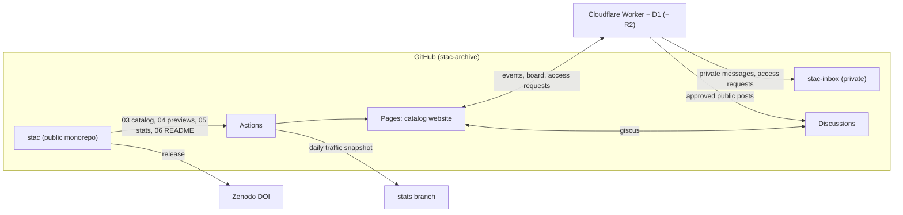

# STAC on GitHub: analysis, architecture and migration plan

*Prepared 22 October 2026 by Thomas Knopf (GESIS) as a proposal for the STAC moderators. Status: prototype; nothing here is official until the moderators decide.*

## 1. Summary

STAC (Kenett, Silvia & Benedek, 2026) lives on OSF as a folder tree of 90 instrument folders. OSF stores and versions the files well, but it offers no faceted search, no previews of survey files, no structured metadata, no review workflow for contributions and only coarse download statistics. This proposal moves STAC to a GitHub monorepo with a static catalog website, a small serverless backend for the things GitHub cannot do, and Zenodo for DOIs. The OSF project stays as the frozen, citable legacy record, because the published paper points to it.

The prototype in this repository is complete enough to judge the approach. All 90 instruments are migrated 1:1, the catalog website runs on the real data with previews of 141 files, and the R pipeline, GitHub workflows, issue forms, governance documents and backend are in place. Deployment needs a GitHub organisation, a Cloudflare account and decisions on licensing and data protection (section 11).

## 2. What is in the OSF archive

The OSF storage archive (`osfstorage-archive.zip`, downloaded 22 October 2026) holds 316 files (134 MB):

| Item | Count |
|---|---|
| Instrument folders | 90 (Art and Aesthetics 15, Creativity 49, Personality and Individual Differences 26) |
| Instrument files (without READMEs) | 224: 79 PDF, 66 DOCX, 6 DOC, 40 MediaLab `.que`, 20 Qualtrics `.qsf`, 7 ZIP, 4 JPG, 2 XLSX |
| READMEs | 88 `README.md` plus one `AQT_README.md`; 5DCS has none |
| Languages | 12 (English in 76 instruments, German 16, French 6, Spanish 3, Japanese, Korean, Polish, Turkish 2 each; Arabic, Farsi, Dutch, Russian 1 each) |
| Survey or task software | 53 instruments with `.qsf` or `.que`, 5 with PsychoPy or MATLAB archives |

These figures agree with the paper (more than 85 measures, 12 languages, mainly PDF and Word plus MediaLab and Qualtrics files). The paper's count of 205 files excludes supporting materials; the archive additionally contains 11 published article PDFs, 4 stimulus images and similar files.

### 2.1 Findings of the migration audit

The full list is in [`audit-report.md`](audit-report.md); every finding is also shown on the instrument's catalog page.

| Finding | Affected |
|---|---|
| The OSF project has **no license** ("No License"); READMEs refer to a wiki for licensing details | whole archive |
| README contains `NA` for citation or administration/scoring | 56 instruments |
| No DOI in any reference | 59 instruments |
| README and folder contents disagree (files not described: 15 folders; README lists files that do not exist: 8 folders) | 23 folders |
| Qualtrics exports still carry `SurveyOwnerID` and the institution's brand ID (`uncg`, `technioniit`, `niu`) | all 20 `.qsf` |
| Qualtrics survey contains an unedited default question ("Click to write the question text") | 11 `.qsf` |
| `POLYFT_IDGRP.zip` is 79.5 MB, of which 75.3 MB is an embedded `.git` folder plus 922 `__MACOSX` entries; the actual content is about 5 MB uncompressed | 1 file |
| PsychoPy archives contain a `data/` folder with recorded test runs | 2 files |
| Published article PDFs redistributed next to the instruments (publisher license to be checked) | 11 files in 7 instruments |
| Instrument file names without language token | 9 files |
| Folder names mix en dashes and hyphens; two contain double spaces; one file name has a typo ("Englsih") | cosmetic |

Two technical facts shaped the design. First, MediaLab `.que` files are Microsoft Access (Jet) databases; they can be read at build time with mdbtools, but not in a browser. Second, the free-text README is the only metadata source on OSF, and the drift between READMEs and folders shows that this does not scale with more contributors.

## 3. OSF features and their GitHub equivalents

| OSF feature | GitHub solution | Limitation to know |
|---|---|---|
| File storage, versioning | Git history; per-instrument folders | Files > 100 MB are rejected, > 50 MB warned (GitHub, n.d.-a). After cleaning PolyFT the repo needs no Git LFS; the free LFS quota is 10 GiB storage and 10 GiB bandwidth (GitHub, n.d.-b). |
| Project DOI | Zenodo GitHub integration: DOI per release plus concept DOI | Legacy OSF DOI stays; Zenodo records link to it (`isNewVersionOf`). |
| Wiki | `README.md`, `docs/`, catalog pages | |
| Contributors, permissions | Organisation teams, five base roles, `CODEOWNERS`, rulesets | Custom repository roles exist only on GitHub Enterprise Cloud (GitHub, n.d.-c), so the design uses base roles plus teams. |
| Download counts per file | Release asset `download_count` (permanent) plus a privacy-preserving counter in the backend | GitHub has no per-file download counter; the traffic API covers only the last 14 days (GitHub, n.d.-d), so a daily workflow archives it. |
| View counts | Archived traffic snapshots; backend counter on the website | |
| Comments | GitHub Discussions, embedded per instrument with giscus | Discussions need a GitHub account; visitors without one write through the moderated board. |
| Private contact | Backend forwards to a private inbox repository | GitHub has no private messages. GitLab's Service Desk would cover this natively (GitLab, n.d.); GitHub was chosen for Zenodo, Discussions and reach. |
| Tags | Repository topics, `stac.yml` tags, catalog facets | |
| Forks | GitHub forks; `provenance.derived_from` for adaptations and translations | Forks are per repository, not per instrument. |
| Activity log | Commit history (authors shown as pseudonyms on the site) and the backend's pseudonymised event log | |
| Read restrictions | Not possible in a public repository | Restricted materials go to a private R2 bucket behind access requests, or to a Zenodo record with restricted access. |

## 4. Target architecture

* **Repository** (`instruments/`, `schema/`, `config/`, `scripts/`, `site/`, `worker/`, `governance/`, `migration/`, `docs/`). One monorepo keeps one DOI, one review process and one history; a repository per instrument would give per-instrument stars and forks but multiply administration by 90.
* **R pipeline** (`scripts/00_helpers.R` holds all functions): `03` builds `catalog.json` from `stac.yml` plus the real file inventory, `04` creates previews (LibreOffice to PDF, mdbtools for MediaLab, JSON parsers for Qualtrics, LimeSurvey and XML, zip listings, haven codebooks), `05` collects statistics, `06` regenerates the README tables, `07` is the CI gate, `08` writes per-instrument release bundles, `09` turns a submission issue into a draft folder.
* **Website** (`site/`): static HTML/CSS/JS, no build tool; the published site stays well below the 1 GB Pages limit (about 60 MB with previews; GitHub, n.d.-f). MiniSearch provides typo-tolerant full-text search, pdf.js renders PDF previews onto canvas, highlight.js formats code.
* **Backend** (`worker/`): a Cloudflare Worker with a D1 database. It counts events without storing IP addresses, forwards private messages and anonymous reports to the inbox repository, queues public posts for moderation, handles access requests with signed links valid for 7 days, and gives moderators a pseudonymised event log (JSON or CSV). Tests: 21 of 21 pass against an in-memory SQLite stand-in; it has not yet run on Cloudflare itself.

## 5. Metadata model

Each instrument folder keeps its human-readable `README.md` and gains a machine-readable `stac.yml` validated against `schema/stac-instrument.schema.json`. Key fields: `id`, `acronym`, `title`, `section`, `subsection`, `kind`, `summary`, `tags`, `access` (tier, statement, verified), `files[]` (path, languages, platform, role, citation per file), `references`, `dois`, `administration`, `contributors` (with ORCID), `provenance` (OSF path, derived_from), `version`.

The 90 drafts were generated by `02_bootstrap_metadata.R` from the READMEs and file names. Everything inferred is marked: `tags_curated: false`, `access.verified: false`, `status.stage: migrated-draft`. Curators confirm these fields over time; the quality score on the site (README present, no NA fields, no drift, languages stated, DOI present, license verified, clean files) shows where work is needed. Current distribution: 18 gold, 52 silver, 18 bronze, 2 draft.

## 6. Website

What the prototype does:

* **Search and selection**: full-text search across acronyms, titles, constructs, languages, platforms, file names and references; facets for section, type, language, platform, file type, access tier, metadata quality and "ready to run"; construct tags; grid and list views; a selection tray that copies the references or a CSV of all selected instruments.
* **Instrument dossier**: badges for access tier, license verification, metadata quality, platforms, languages and OSF downloads; actions to download all (release bundle), copy citation, fork, follow, report an error and copy a link; tabs for files with in-browser preview, about (overview, administration, original README), cite (per-file references, DOIs, STAC access point), history (Git log plus migration record), quality (score and audit findings) and discuss (giscus thread plus private channels).
* **Previews**: PDF; Word, LibreOffice and PowerPoint converted to PDF; Excel as table; Qualtrics and MediaLab as item lists with response labels; LimeSurvey and generic XML outlines; zip contents with junk highlighted; CSV tables; SPSS, Stata and RDS codebooks; code with syntax highlighting; images and media.
* **Dashboard**: archive composition, legacy OSF downloads, live views and downloads, migration audit, GitHub figures and the moderators' activity log. Panels without data can show clearly labelled demo data.
* **Message board**: public board (GitHub Discussions plus moderated posts), private message, anonymous error report, request for a missing measure, access request.
* **Accessibility and craft**: keyboard navigation (`/` focuses search, `Esc` closes), visible focus, light and dark theme, works at 400 px width, no cookies.

### 6.1 Current practice the design follows

* README conventions on GitHub: theme-aware banner via `<picture>` and `prefers-color-scheme`, Markdown alerts (`> [!NOTE]`), Mermaid diagrams, badges, collapsible tables (`
`).
* Issue forms and discussion category forms in YAML instead of free-text templates (GitHub, n.d.-e), with `blank_issues_enabled: false` and contact links.
* `CITATION.cff` (GitHub's "Cite this repository" button) and `.zenodo.json` for release metadata.
* Rulesets, CODEOWNERS and required status checks instead of ad-hoc branch protection.
* Static search in the browser, as used by documentation sites, instead of a search server.
* Structured, versioned questionnaire metadata, in the spirit of ReproSchema (Chen et al., 2025), kept deliberately simpler.

## 7. Rights and roles

| Role | GitHub mechanism | Can |
|---|---|---|
| Visitor (no account) | none | browse, preview, download open files; private message, anonymous report, access request via backend |
| GitHub user | public repo | discussions, issues, forks, pull requests |
| Contributor | pull requests from forks | propose files and metadata |
| Curator (per section) | team with Triage | label, triage, moderate posts |
| Section maintainer | team with Maintain plus CODEOWNERS | approve and merge in their section |
| Moderator | organisation owner / Admin; Cloudflare Access group | everything, including private inbox, access requests, activity log |

Details, team setup and the ruleset import are in [`governance/roles-matrix.md`](../governance/roles-matrix.md). Two-factor authentication is required for all members with write access.

## 8. Tracking and privacy

* No cookies. Each event stores a visitor hash `HMAC(secret, date | IP | user agent)`; the date in the input makes the hash change daily, so visitors cannot be followed across days. IP addresses and user agents are never stored.
* Opt-in pseudonyms: a visitor can choose to keep a random ID in the browser; events then carry a stable pseudonym such as `curious-otter-3f9a`, which lets the visitor see their own history.
* Retention: raw events 90 days, daily aggregates indefinitely. Messages and e-mail addresses only in the private inbox.
* Pseudonymised data are still personal data under the GDPR. Before launch the hosting institution must name a controller, choose a legal basis (legitimate interest for counting; consent for the opt-in ID), complete [`PRIVACY.md`](../PRIVACY.md) and have it checked by its data protection officer. Messages need a retention rule.

## 9. File formats

The format registry (`config/formats.yml`) maps extensions to a label, family, platform and preview strategy; platform tokens in file names (`_Qualtrics`, `_Unipark`, `_SoSci`, `_LimeSurvey`, `_REDCap`, `_Prolific`, `_Gorilla`, `_jsPsych`, `_labjs`, `_formr` and others) refine it.

| Platform or format | How it is handled |
|---|---|
| Qualtrics `.qsf` (JSON) | Parsed: survey name, language, brand, items in block order, choices and matrix scales; flags owner IDs and default questions |
| MediaLab `.que` (Access DB) | Read with mdbtools: question number, variable name, type, wording, point labels |
| LimeSurvey `.lss/.lsq/.lsg` (XML), `.lsa` (zip) | Question list from XML; archive listing |
| SoSci Survey, Unipark/Tivian EFS exports | XML outline; platform from the file name token. Export structures differ between versions, so these are treated as opaque packages until real files arrive. |
| Prolific | Prolific has no questionnaire file format; studies are configured online. Store screener settings, study texts or exports as `.json`, `.csv` or `.md` with the `_Prolific` token. |
| REDCap data dictionary (`.csv`) | Table preview |
| PsychoPy `.psyexp`, OpenSesame, Inquisit, E-Prime, Presentation, MATLAB | XML outline or code view where readable; otherwise download only |
| PDF, Word, LibreOffice, PowerPoint, Excel, CSV | PDF preview (converted at build time); spreadsheets also as tables |
| SPSS `.sav/.por`, Stata `.dta`, SAS, R `.rds` | Codebook (variables, labels, types, missing) via haven |
| R, Python, Stata do-files, Quarto, Markdown, SPSS syntax, Mplus | Syntax-highlighted source |

Not every format was tested with real files: the archive contains only PDF, Word, Excel, MediaLab, Qualtrics, ZIP and JPG. Parsers for LimeSurvey, SoSci, EFS, data files and code follow the published formats and should be checked once the first real contributions arrive.

## 10. Migration plan

| Phase | Steps | Who |
|---|---|---|
| 0. Decide | Approve this concept; decide licensing (section 11); choose organisation name and hosting institution for the backend; name the data controller | Moderators |
| 1. Set up | Create GitHub organisation, teams (moderators, section curators, infra), 2FA; create `stac` (public) and `stac-inbox` (private); enable Pages (source: GitHub Actions) and Discussions with categories `q-a`, `instrument-feedback`, `used-in-research`, `ideas`; import rulesets; add secrets (`STATS_TOKEN`, Cloudflare); connect Zenodo and create the Zenodo community `stac` | Infra maintainer |
| 2. Import | Push this repository; run `05_fetch_stats.R --osf-legacy` once to replace the paper's lower bounds with exact per-file OSF download counts; first build and deploy | Infra maintainer |
| 3. Curate (rolling) | Work through the audit: confirm access statements with authors, add missing citations and DOIs, fix README drift, decide on the reference PDFs, ask authors for cleaned PolyFT and PsychoPy archives and neutral Qualtrics exports; each fix is a reviewed pull request | Curators |
| 4. Backend | Deploy the Worker, D1 and Turnstile; complete PRIVACY.md with the DPO; set `backend.api_base`; enable giscus | Infra maintainer, DPO |
| 5. Launch | First release `v2026.10.0-osf-snapshot` from the unchanged migration commit (its DOI equals the OSF content), then normal releases; announce via APA Division 10, SNC and the journal; update the OSF project: description and wiki point to GitHub, optionally connect the GitHub add-on so the OSF file view shows the repository (Center for Open Science, n.d.) | Moderators |
| 6. Freeze OSF | Keep the OSF project and its DOI as the legacy record; no new uploads, no deleting or moving of files (GUID links such as `osf.io/a5cps`); notice texts and add-on options in [`osf-after-migration.md`](osf-after-migration.md); OSF download counts refreshed monthly by `osf-legacy-stats.yml` | Moderators |

## 11. Open decisions and risks

1. **License.** The OSF project had none. Recommended: keep per-instrument access tiers (default academic, non-commercial), MIT for code, CC0 for metadata. The 11 article PDFs need a decision (keep where licensed CC BY, otherwise replace with DOI links).
2. **Ownership.** Which institution hosts the backend and acts as data controller (Graz, Technion, UNCG, APA Division 10, or GESIS)?
3. **Authors' files stay 1:1** for now, as decided. Problems are flagged, not fixed. Cleaned versions should come from the authors, so authority stays with them.
4. **Bus factor.** GitHub Actions and the Worker need one person who maintains them. GOVERNANCE.md defines succession; the R pipeline was kept small for this reason.
5. **GitHub as a single platform.** Zenodo deposits of every release protect against loss; the OSF record stays.
6. **Counting is not comparable with OSF.** OSF counts file downloads; the new site counts events (views, previews, downloads) and release bundle downloads. The dashboard keeps legacy and new figures apart.

## References

Center for Open Science. (n.d.). *Connect GitHub to a project*. OSF Support. https://osf-support.helpscoutdocs.com/article/211-connect-github-to-a-project

Chen, Y., Jarecka, D., Abraham, S. A., Gau, R., Ng, E., Low, D. M., Bevers, I., Johnson, A., Keshavan, A., Klein, A., Clucas, J., Rosli, Z., Hodge, S. M., Linkersdörfer, J., Bartsch, H., Das, S., Fair, D., Kennedy, D., & Ghosh, S. S. (2025). Standardizing survey data collection to enhance reproducibility: Development and comparative evaluation of the ReproSchema ecosystem. *Journal of Medical Internet Research, 27*, Article e63343. https://doi.org/10.2196/63343

GitHub. (n.d.-a). *About large files on GitHub*. GitHub Docs. https://docs.github.com/en/repositories/working-with-files/managing-large-files/about-large-files-on-github

GitHub. (n.d.-b). *Git Large File Storage billing*. GitHub Docs. https://docs.github.com/en/billing/concepts/product-billing/git-lfs

GitHub. (n.d.-c). *About custom repository roles*. GitHub Docs. https://docs.github.com/en/organizations/managing-user-access-to-your-organizations-repositories/managing-repository-roles/about-custom-repository-roles

GitHub. (n.d.-d). *REST API endpoints for repository traffic*. GitHub Docs. https://docs.github.com/en/rest/metrics/traffic

GitHub. (n.d.-e). *Creating discussion category forms*. GitHub Docs. https://docs.github.com/en/discussions/managing-discussions-for-your-community/creating-discussion-category-forms

GitHub. (n.d.-f). *GitHub Pages limits*. GitHub Docs. https://docs.github.com/en/pages/getting-started-with-github-pages/github-pages-limits

GitLab. (n.d.). *Configure Service Desk*. GitLab Docs. https://docs.gitlab.com/user/project/service_desk/configure/

Kenett, Y. N., Silvia, P. J., & Benedek, M. (2026). Scales and Tasks for Art and Creativity Assessment (STAC). *Psychological Test Adaptation and Development, 7*, 239–244. https://doi.org/10.1027/2698-1866/a000140
